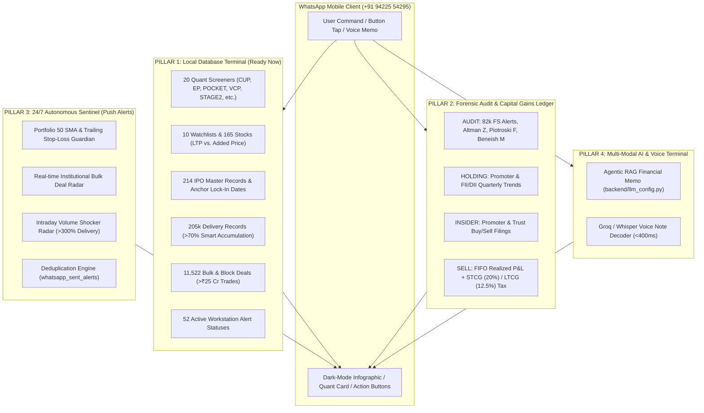

# APEXQUANT • DATABASE-CENTRIC ENTERPRISE WHATSAPP TERMINAL
## Strategic Architecture & Implementation Roadmap

> **Status**: Ready for Pillar-by-Pillar Execution  
> **Environment**: Personal Solo Workstation (100% Free Meta WhatsApp Sandbox — Zero Publishing Required)  
> **Core Strategic Paradigm**: **Local-First, Database-Centric Architecture**.  
> The workstation already holds **over 300,000+ structured records** across local SQLite databases (`watchlist_database.db`, `ipo_cache.db`, `ipo_ai_insights.db`). The bot acts as an **ultra-fast (<15ms) local query terminal** with zero external scraper latency or API rate limits.

---

## 1. Verified Local Database Inventory

```
┌─────────────────────────────────────────────────────────────────────────────────────────┐
│                           LOCAL DATABASE INVENTORY                                      │
├───────────────────────────────┬──────────────────────────────────┬──────────────────────┤
│ Operational Domain            │ Database Table                   │ Record Count in DB   │
├───────────────────────────────┼──────────────────────────────────┼──────────────────────┤
│ 1. Quant Screeners (20 Types) │ screener_results_cache           │ 20 pre-computed algorithms
│ 2. Watchlists & Pre-Saved     │ watchlists, watchlist_items      │ 10 lists (165 stocks)│
│ 3. IPO Master & Lock-ins      │ ipo_cache.db (ipo_master)        │ 214 IPOs + lock-ins  │
│ 4. IPO AI Qualitative Research│ ipo_ai_insights.db               │ Active dossiers      │
│ 5. Institutional Bulk Deals   │ bulk_block_deals                 │ 11,522 transactions  │
│ 6. Delivery History & Stats   │ daily_delivery_history, stats    │ 205,227 records      │
│ 7. Financial Statement Audits │ fs_alert_history, fs_alerts      │ 82,785 records       │
│ 8. Active Workstation Alerts  │ alerts, alert_settings           │ 52 active alerts     │
│ 9. Superstar Shark Portfolios │ cached_shark_investors, lookup   │ 61 investors         │
│ 10. Insider Trades & Ownership│ cached_trades, shareholdings     │ Active quarterly data│
│ 11. Active Portfolio Engine   │ portfolio_items                  │ FIFO netting active  │
└───────────────────────────────┴──────────────────────────────────┴──────────────────────┘
```

---

## 2. Strategic Pillar Architecture

Instead of arbitrary calendar phases, the roadmap is organized into **4 Functional Pillars**, prioritizing the database assets already at our disposal:



---

## 3. Detailed Specifications by Pillar

### PILLAR 1: The Local Database Terminal & Quant Screener Suite
*Execution: Instant — Direct SQLite queries running in <15ms.*

#### 1.1 Master Screener Directory (`SCREENS` or `QUANTS`)
* Queries `screener_results_cache` to display available pre-computed strategies:
  * **Classical Base Breakouts**: `CUP` (Cup & Handle), `FLAT` (Flat Base), `VCP` (Volatility Contraction), `STAGE2` (Weinstein Mark-up).
  * **Momentum & Tightness**: `HTF` (High Tight Flag), `3WT` (3-Weeks Tight Closes), `RSNH` (Relative Strength Line at 52W High).
  * **Catalyst & Volume Triggers**: `EP` (Episodic Pivot Gap-Ups), `POCKET` (Morales/Kacher Pocket Pivots), `KELL` (Oliver Kell Reversal), `UR` (Undercut & Rally).
  * **Multi-Timeframe**: `CONFLUENCE`, `DIVERGENCE`, `MTF`.
* Every screener command formats the **Top 5 stocks** with entry pivot price, stop loss, and volume multiple, appending 1-tap buttons:
  `[ 📈 Chart #1 ]   [ ➕ Add to Watchlist ]   [ 🎯 Other Screens ]`

#### 1.2 Watchlist Intelligence (`WATCHLIST`, `WATCHLISTS`, `WATCH <SYM>`, `UNWATCH <SYM>`)
* **`WATCHLIST`**: Loads your primary watchlist (`MyFav1`), comparing live LTP against the recorded **`added_price`**:
  ```text
  📋 ACTIVE WATCHLIST: MyFav1 (5 Assets)
  ━━━━━━━━━━━━━━━━━━━━
  1. BOSCHLTD   ₹ 47,625.00  (+4.44% today | +18.2% since added)
  2. BSOFT      ₹    640.00  (+1.10% today | +113.4% since added)
  3. TCS        ₹  3,810.00  (-0.85% today | -2.4% since added)
  ━━━━━━━━━━━━━━━━━━━━
  [ 🚀 Scan Breakouts ]   [ 🌐 Market Pulse ]   [ 💼 All Watchlists ]
  ```
* **`WATCHLISTS`**: Lists all 10 custom watchlists in DB (`MyFav1`, `Confluence Tier 1`, `Shark Ashish Kacholia`, etc.) with 1-tap view buttons.
* **`WATCH <SYM>`**: Inserts stock into SQLite with current price as baseline.
* **`UNWATCH <SYM>`**: Removes stock from active list.

#### 1.3 IPO Radar (`IPO`, `IPO <SYM>`)
* Queries `backend/data/ipo_cache.db` (`ipo_master` with 214 records):
  * **`IPO`**: Top 5 most recent/upcoming IPOs with issue price, listing price, listing gains %, subscription multiple, and **anchor lock-in 30d/90d expiry dates**.
  * **`IPO <SYM>`** *(e.g. `IPO SWIGGY`)*: Full IPO dossier combining issue stats with qualitative business model insights from `ipo_ai_insights.db`.

#### 1.4 Smart Delivery Accumulation (`DELIVERY`)
* Queries `daily_delivery_stats` (2,936 stocks):
  * Surfaces top stocks where **delivery percentage $>70\%$** on $>1.5\times$ 10-day average volume (smart money accumulation vs speculative intraday churn).

#### 1.5 Institutional Bulk Deals (`DEALS <SYM>` or `DEALS`)
* Queries `bulk_block_deals` (11,522 rows):
  * Surfaces the largest recent FII/DII institutional block trades ($>₹25\text{ Cr}$) in any requested symbol.

#### 1.6 Active Workstation Alerts (`ALERTS`)
* Queries the `alerts` table (52 rows):
  * Summarizes your active price alerts, shark radar triggers, and breakout conditions.

---

### PILLAR 2: Forensic Fundamental Audit & Trade Ledger
*Execution: In-depth financial analysis leveraging local statement caches.*

#### 2.1 Forensic Audit (`AUDIT <SYM>`)
* Combines `cached_financial_statements` and `fs_alert_history` (82,782 records):
  * **Altman Z-Score**: Financial distress / bankruptcy likelihood.
  * **Piotroski F-Score**: 9-point fundamental health trend.
  * **Beneish M-Score**: Aggressive revenue recognition / manipulation risk.
  * **Cash Flow Quality (CFO / PAT)**: True cash generation vs paper accounting profit.
  * **Financial Statement Alerts**: Specific deterioration warnings flagged by workstation algorithms (e.g. asset turnover drop, debt surge).

#### 2.2 Ownership & Insider Tracker (`HOLDING <SYM>`, `INSIDER <SYM>`)
* **`HOLDING <SYM>`**: Quarterly FII, DII, and Promoter stake changes from `cached_shareholdings`.
* **`INSIDER <SYM>`**: Recent insider buying and selling from `cached_trades`.

#### 2.3 Trade Execution & Tax Calculator (`SELL <SYM> <QTY> <PRICE>`)
* Closes active portfolio holdings via FIFO netting.
* Computes realized capital gains and estimates tax liability under Indian rules:
  - **Short-Term Capital Gains (STCG @ 20%)** for holdings held $< 12$ months.
  - **Long-Term Capital Gains (LTCG @ 12.5%)** for holdings held $> 12$ months (accounting for the ₹1.25 Lakh exemption).
  - Updates cash balance in portfolio ledger.

---

### PILLAR 3: 24/7 Autonomous Sentinel (Proactive Push Alerts)
*Execution: Background market-hours scheduler (09:15 – 15:30 IST) with deduplication.*

#### 3.1 Proactive Trigger Rules
1. **Stop-Loss & 50 SMA Guardian**: Alerts if any portfolio holding breaches its trailing 20 EMA, 50 SMA, or a custom -6% drawdown threshold.
2. **Real-Time Block Deal Alert**: Alerts when an institutional deal $>₹25\text{ Cr}$ hits any of your 165 watchlist stocks.
3. **Delivery Volume Spike**: Alerts when a watchlist stock surges $>3\%$ with $>300\%$ delivery volume.
4. **Earnings & Corporate Action Advance Notice**: Pushes a warning 24 hours before earnings announcements, splits, or dividends.

#### 3.2 Anti-Spam Deduplication Engine
* Maintains `whatsapp_sent_alerts` in SQLite so you never receive duplicate notifications for the same symbol on the same day.

---

### PILLAR 4: Multi-Modal AI & Hands-Free Voice Terminal
*Execution: LLM RAG engine + Groq / Whisper transcription.*

#### 4.1 Conversational RAG Financial Analyst
* Routes unformatted questions to `backend/llm_config.py` with localized context from `screener_universe` and `cached_profiles`.
* Delivers 3-bullet institutional analyst memos for queries like:
  - *"Is Bosch fairly valued after today's 4.4% rise?"*
  - *"Compare Tata Motors and Maruti Suzuki on operating margins and EV/EBITDA."*

#### 4.2 WhatsApp Voice Notes (Whisper)
* Send a 5-second voice note while driving.
* Backend downloads the `.ogg` audio, transcribes via Whisper in $<400\text{ ms}$, executes the command, and replies with charts and formatted cards.

---

## 4. Implementation Schedule

| Sequence | Target Milestone | Components Covered | Estimated Completion |
| :---: | :--- | :--- | :---: |
| **Milestone 1** | **Pillar 1: Local Database Terminal** | 20 Quant Screeners (`SCREENS`, `CUP`, `EP`, etc.), 10 Watchlists (`WATCHLIST`, `WATCH`), 214 IPOs (`IPO`), Delivery & Deals (`DELIVERY`, `DEALS`), Active Alerts (`ALERTS`), Dynamic Action Buttons | **Next Step** |
| **Milestone 2** | **Pillar 2: Forensic Audit & Tax Ledger** | `AUDIT <SYM>`, `HOLDING <SYM>`, `INSIDER <SYM>`, `SELL <SYM>` with STCG/LTCG tax | Follow-up |
| **Milestone 3** | **Pillar 3: 24/7 Autonomous Sentinel** | Background market-hours monitor, stop-loss guardian, block deal detector, deduplication engine | Follow-up |
| **Milestone 4** | **Pillar 4: AI RAG & Voice Terminal** | Unstructured conversational questions, Whisper audio transcription | Final Phase |
